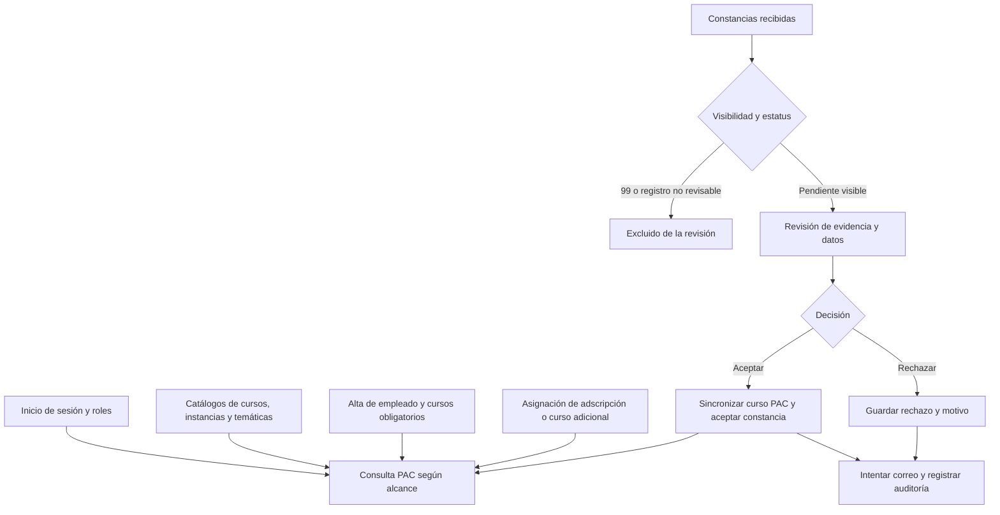

# Resumen integral de PAC Check Engine

Fecha de revisión: **28 de octubre de 2026**, zona America/Mexico_City.

Este documento describe el código y la base configurada en el proyecto `pac-check-engine`. Las cifras corresponden a esa conexión durante la revisión; no se presume que coincida con producción. Se revisaron rutas, controladores, modelos, reglas de visibilidad, componentes Vue, vistas Blade, configuración, migraciones y pruebas. Las consultas a datos se ejecutaron en transacciones de solo lectura, con límites de tiempo y cierre mediante rollback. No se modificaron registros ni se enviaron correos.

El análisis combina comportamiento comprobado por código, datos agregados y pruebas automatizadas. Los riesgos deducidos del código se señalan como tales. No se efectuaron pruebas de carga, una navegación completa con cada perfil ni operaciones de escritura sobre la base configurada. El único cambio de esta revisión es este documento.

## 1. Propósito y alcance funcional

PAC Check Engine es una aplicación administrativa de capacitación con identidad visual de IMSS Bienestar. Su función principal es relacionar la plantilla de personal con sus cursos de capacitación, registrar su avance y revisar la evidencia presentada mediante constancias.

El sistema permite iniciar sesión, consultar la información de la cuenta, buscar empleados y cursos, actualizar registros PAC, agregar cursos a empleados existentes, asignar adscripciones, dar de alta empleados, administrar catálogos, revisar constancias y administrar usuarios. Registra eventos de las principales operaciones y notifica por correo las decisiones sobre constancias.

La unidad principal de trabajo en PAC es una **asignación de curso a un empleado**, identificada por `id_empl_accion`. Una persona puede tener varios cursos y la relación con la plantilla utiliza puesto y CURP. Por ello, las filas de cursos y las filas de plantilla no deben interpretarse como personas únicas.

El repositorio concentra la revisión de constancias ya recibidas. No se identificó una ruta de captura pública o carga de nuevas constancias, ni un generador de certificados PDF en estos flujos. El documento de evidencia se consulta mediante un enlace almacenado. La existencia de tablas auxiliares, temporales o históricas en PostgreSQL tampoco implica que exista una pantalla para administrarlas.

## 2. Arquitectura y tecnologías

| Capa | Implementación observada |
|---|---|
| Servidor | PHP 8.2.12 en el entorno revisado; proyecto compatible con PHP ^8.2. |
| Framework | Laravel 12; versión instalada consultada: 12.51.0. |
| Interfaz | Blade para las páginas y Vue 3 para tablas, formularios, filtros y modales. |
| Compilación | Vite; la compilación ejecutada utilizó Vite 7.1.12. |
| Base operativa | PostgreSQL, con esquemas `public`, `administracion` y `log`. |
| Consultas | Eloquent, Query Builder y expresiones SQL específicas de PostgreSQL. |
| Interacción | Axios y algunas llamadas `fetch`; notificaciones con Notyf y confirmaciones con SweetAlert2. |
| Presentación | Bootstrap, recursos de Soft UI Dashboard, CSS propio y dependencias de Tailwind. |
| Acceso | Sesiones web de Laravel, contraseñas con hash, captcha y roles almacenados en base. |
| Correo | Servicio de notificaciones de constancias sobre el mailer de Laravel. |
| Pruebas | PHPUnit y pruebas de JavaScript con el ejecutor de Node. |

La aplicación es un monolito: Laravel entrega páginas y endpoints JSON dentro del mismo proyecto. `resources/js/app.js` monta ocho componentes Vue según el contenedor presente en la página. No se observó una aplicación SPA con router independiente.

Las rutas se cargan desde archivos por módulo mediante `routes/web.php`. Se registraron **53 rutas en total**, incluidas las provistas por el framework. Las operaciones se protegen con autenticación y, según el caso, middleware de rol o validaciones internas del controlador.

Aunque la configuración conserva conexiones de ejemplo para otros motores, el código operativo depende de PostgreSQL: usa `ILIKE`, `DISTINCT ON`, `unaccent`, conversiones `::`, expresiones regulares, bloqueos de filas y bloqueos transaccionales. Cambiar solamente `DB_CONNECTION` no basta para migrarlo a otro motor.

Fuentes: [dependencias PHP](../composer.json), [dependencias frontend](../package.json), [montaje Vue](../resources/js/app.js), [arranque](../bootstrap/app.php), [rutas](../routes/web.php).

## 3. Módulos del sistema

### 3.1. Autenticación

El inicio de sesión valida correo, contraseña y captcha. La autenticación exige una cuenta con `status = true`; una cuenta inactiva no puede iniciar una nueva sesión. Tras autenticarse se regenera la sesión y se devuelve al usuario una redirección a PAC.

El controlador limita los intentos fallidos por combinación de correo e IP: utiliza un umbral de diez intentos y una ventana de sesenta segundos. Registra accesos exitosos, fallidos, bloqueados y cierres de sesión. Al salir invalida la sesión y regenera el token CSRF.

No se identificaron rutas de autorregistro, recuperación de contraseña o autenticación de dos factores. La administración de contraseñas disponible está dentro de usuarios.

Fuente: [AuthLoginController](../app/Http/Controllers/Auth/AuthLoginController.php).

### 3.2. Mi sesión

Presenta los datos de la cuenta autenticada, su estado, entidad, nómina, CLUES y roles activos. La consulta toma el identificador de la sesión; no permite elegir otro usuario mediante un parámetro. También existe una ventana informativa en el menú.

Fuente: [MiSesionController](../app/Http/Controllers/MiSesionController.php).

### 3.3. PAC / Mi plantilla

Es el módulo principal. Lista asignaciones de cursos con datos del empleado, CURP, acción y condición de atención. Permite búsquedas, paginación y filtros por persona, CURP, acción, validación de plantilla y condición pendiente/concluido. Los administradores disponen de filtros adicionales por entidad, nómina y CLUES.

Al abrir un registro muestra datos de la persona, información del curso, horas, fechas, trimestre, calificación, finalidad, instancia, temática, observaciones y adscripción. El detalle también calcula un total de horas por CURP.

La actualización manual valida fechas hasta el día actual, orden entre inicio y fin, calificación entre 70 y 100 con hasta dos decimales y existencia de los elementos seleccionados en sus catálogos. Cuando se asigna un estatus de curso, exige los campos necesarios para avanzar el registro. El trimestre se obtiene de la fecha final comparando mes y día con el catálogo, de modo que los rangos base pueden reutilizarse entre años.

El listado conserva cursos históricos concluidos aunque después el catálogo cambie a no vigente. Para pendientes se exige que el curso esté vigente y que el registro del empleado tenga estatus nulo, vigente o alta. La consulta de plantilla admite empleados con `activo` nulo, 1 o 2 y excluye otros valores.

Fuentes: [TablePacModel](../app/Models/Pac/TablePacModel.php), [DataPacModel](../app/Models/Pac/DataPacModel.php), [SavePacController](../app/Http/Controllers/Pac/SavePacController.php), [GetTrimestreModel](../app/Models/Pac/Helpers/GetTrimestreModel.php).

### 3.4. Agregar cursos a un empleado

Permite seleccionar un curso vigente para un empleado que ya tiene un registro PAC accesible. Comprueba que no tenga asignado ese curso para el mismo puesto y CURP. Crea una asignación nueva con consecutivo, duración programada y campos de ejecución pendientes.

Este permiso se concede a administradores y revisores estatales. Los supervisores no reciben esta capacidad por el solo hecho de tener su rol. La operación se ejecuta dentro de una transacción, utiliza bloqueos y deja auditoría.

Fuente: [CoursePacController](../app/Http/Controllers/Pac/CoursePacController.php).

### 3.5. Adscripción, unidad y coordinación

La asignación parte del catálogo oficial de adscripciones. Al seleccionar una adscripción se obtienen la unidad y la coordinación relacionadas. La actualización afecta a la fila de plantilla identificada por puesto y CURP.

Un detalle técnico relevante es que **`a2_acciones_capacitacion.num_cursos` almacena el identificador de adscripción**. En estos flujos no representa una cantidad de cursos. El detalle PAC relaciona ese campo con `cat_adscripcion.id_adscripcion`.

Administradores y revisores estatales pueden modificar esta asignación dentro de su alcance. El código contempla un alcance opcional de administrador por adscripción, condicionado a que exista la columna correspondiente en usuarios.

Fuentes: [UnidadCoordinacionPacController](../app/Http/Controllers/Pac/UnidadCoordinacionPacController.php), [AdscripcionCatalogs](../app/Support/AdscripcionCatalogs.php).

### 3.6. Alta de empleados

Disponible para administrador y supervisor de oficinas centrales. Recibe identidad, CURP, datos laborales, puesto, CLUES, nómina, validación y observaciones de plantilla, además de adscripción. Normaliza numerosos textos y comprueba el formato de CURP y la coincidencia del sexo con su carácter correspondiente.

Utiliza catálogos de puestos, CLUES y adscripciones. Contempla la captura manual de CLUES y su incorporación al catálogo cuando procede. Evita altas con una CURP ya existente en plantilla.

El alta calcula identificadores, inserta el registro de plantilla, intenta vincular constancias y tokens por CURP y prepara dos cursos obligatorios: `1000001` y `1000002`. Emplea una fila de plantilla de referencia identificada por una CURP fija para completar ciertos valores no capturados. La transacción incluye bloqueos exclusivos de tablas.

**Limitación comprobada de esquema:** el método de vinculación requiere `id_empleado` tanto en `tbl_constancias` como en `tbl_registros_token`. Esa columna no existe en ninguna de las dos tablas de la conexión revisada. Por ello, el flujo que alcanza esa comprobación no puede completar el alta y debe revertir su transacción. La revisión no ejecutó un alta real.

Fuente: [SaveEmpleadoController](../app/Http/Controllers/Empleado/SaveEmpleadoController.php), especialmente `vincularRegistrosEmpleado()` y `assertEmployeeLinkTableReady()`.

### 3.7. Revisión de constancias

Permite consultar evidencia, revisar datos y aceptar o rechazar registros pendientes. La aceptación sincroniza la información con los cursos PAC del trabajador; el rechazo conserva los cursos existentes. Ambas decisiones intentan una notificación por correo después de guardar el resultado.

| Estatus de constancia | Comportamiento |
|---|---|
| 1 — Pendiente | Admite aceptación o rechazo. |
| 2 — Aceptado | Decisión final para las operaciones disponibles. |
| 3 — Rechazado | Decisión final, con motivo; incluye rechazos por duplicidad. |
| 99 — Oculto | Excluido de las consultas del módulo para todos los usuarios, incluidos administradores. |
| Nulo | Excluido de revisión; no equivale automáticamente a pendiente. |

La exclusión de 99 se aplica en `ConstanciaVisibilityByName` antes de resolver excepciones de administrador. La comparten listado, conteo, búsquedas, opciones de filtro, detalle y consultas que preceden a una decisión. Un acceso directo por identificador a una constancia oculta no debe recuperar el registro. No existe una pantalla nueva para asignar 99 o revertirlo.

Antes de aceptar se validan datos del trabajador, curso, instancia, temática, fechas, horas y trimestre. El curso se busca por su nombre normalizado en el catálogo. Si `instancia_otro` contiene información se solicita confirmar la identidad mostrada. Si existe un curso con fecha final para el mismo puesto, CURP y acción, se abre una confirmación de duplicidad: continuar permite actualizar; cancelar/rechazar guarda un rechazo por duplicidad.

La aceptación también aplica una regla especial: al aceptar el curso `1000011`, puede marcar como no vigente el curso base `1000001` del mismo trabajador cuando este sigue pendiente. Si el curso base ya tiene fecha final se conserva.

La evidencia se abre por enlace; este módulo no genera un PDF ni adjunta la evidencia al correo. Internamente el controlador denomina `CONST_CONCLUIDO` al estatus 2, aunque la etiqueta para el usuario es aceptado.

Fuentes: [visibilidad de constancias](../app/Support/ConstanciaVisibilityByName.php), [actualización de estatus](../app/Http/Controllers/Constancias/UpdateEstatusConstanciasController.php), [interfaz](../resources/js/app/constancias/table.vue).

### 3.8. Catálogos

El catálogo de acciones define cursos con nombre, vigencia, duración, temática, modalidad, tipo y finalidad, además de campos institucionales. El catálogo de instancias define las instituciones que imparten capacitación. El catálogo de temáticas registra su descripción, categorías y enfoque.

Los tres módulos tienen consultas, búsqueda, paginación, alta y edición para perfiles centrales. No se observaron rutas de eliminación para estos catálogos. Parte de sus identificadores y consecutivos se calcula desde los registros existentes.

Puestos, CLUES, entidades, nóminas, finalidades, estatus, trimestres, unidades, coordinaciones y adscripciones sirven como catálogos de apoyo. Su uso en formularios no implica que todos tengan mantenimiento propio en la interfaz. CLUES combina fuentes administrativas y de apoyo según su disponibilidad.

Fuentes: [acciones](../app/Http/Controllers/Action/SaveActionController.php), [instancias](../app/Http/Controllers/Instancia/SaveInstanciaController.php), [temáticas](../app/Http/Controllers/Tematica/SaveTematicaController.php), [catálogos de empleado](../app/Support/EmpleadoCatalogs.php).

### 3.9. Administración de usuarios

Reservada al administrador de oficinas centrales. Incluye consulta, filtros, alta, edición, cambio de contraseña, asignación de uno o más roles, entidad, nómina, CLUES y alcance opcional por adscripción. Valida correos únicos, contraseñas confirmadas con un mínimo de ocho caracteres y referencias existentes de los catálogos.

La operación denominada eliminar realmente desactiva la cuenta; no borra físicamente al usuario. El administrador no puede desactivar su propia cuenta por estas operaciones. La creación y actualización de usuarios y roles se realiza en transacciones y se audita.

Fuente: [AdminUsersController](../app/Http/Controllers/Admin/AdminUsersController.php).

### 3.10. Auditoría y notificaciones

`UserActionLogger` centraliza eventos de autenticación, usuarios, empleados, catálogos, PAC y constancias. Los eventos pueden incluir actor, módulo, acción, referencia, fecha, valores anteriores y nuevos, IP y datos de la petición. Cuando la tabla de auditoría no está disponible, el código intenta registrar la información en el log de Laravel.

Existe además `log.log_info` para cambios de información PAC. No se identificó una pantalla de consulta de auditoría en las rutas revisadas.

El correo de constancias tiene variantes de aceptación, rechazo y duplicidad, destinatario, copias configurables e historial de capacitación. El servicio realiza hasta tres intentos síncronos y registra el resultado. Aunque existe infraestructura de colas en la configuración, este flujo utiliza envío directo; no se identificó una tarea persistida para recuperar notificaciones fallidas.

Fuentes: [UserActionLogger](../app/Support/UserActionLogger.php), [ConstanciaNotificationService](../app/Services/Constancias/ConstanciaNotificationService.php), [correo](../app/Mail/ConstanciaDecisionMail.php).

## 4. Usuarios, permisos y alcance

La base revisada tiene cuatro roles oficiales. La comprobación de roles no distingue mayúsculas y minúsculas.

| Capacidad | Administrador OC | Supervisor OC | Revisor estatal | Supervisor estatal |
|---|---|---|---|---|
| Consultar y actualizar PAC dentro del alcance | Sí | Sí | Sí | Sí |
| Revisar y decidir constancias dentro del alcance | Sí | Sí | Sí | Sí |
| Administrar acciones, instancias y temáticas | Sí | Sí | No | No |
| Dar de alta empleados | Sí | Sí | No | No |
| Agregar cursos a empleados | Sí | No | Sí | No |
| Cambiar adscripción desde PAC | Sí | No | Sí | No |
| Administrar usuarios | Sí | No | No | No |
| Consultar información de su sesión | Sí | Sí | Sí | Sí |
| Consultar constancias con estatus 99 | No | No | No | No |

Los administradores tienen alcance general, salvo la restricción opcional por adscripción cuando está disponible y asignada. Supervisor OC, revisor estatal y supervisor estatal se segmentan por entidad y nómina. HRAES requiere reglas adicionales de CLUES. Una CLUES está reservada a administradores por una regla expresa del código.

Hay una diferencia entre módulos: PAC también limita por CLUES cuando un usuario trae una asignada; constancias utiliza esa condición adicional cuando la nómina requiere CLUES por HRAES. Conviene confirmar que esa diferencia sea intencional.

El código conserva compatibilidad con un rol `ADMIN` en algunas comprobaciones, pero no es uno de los cuatro roles presentes y no figura en todas las rutas restringidas. Tampoco debe confundirse que una ruta PAC exija solamente sesión con que permita todos los datos: el alcance se comprueba dentro de sus consultas y operaciones.

Fuentes: [rutas por módulo](../routes/app), [RoleMiddleware](../app/Http/Middleware/RoleMiddleware.php), [PacVisibility](../app/Support/PacVisibility.php), [ConstanciaVisibilityByName](../app/Support/ConstanciaVisibilityByName.php).

## 5. Organización de la información

| Tabla o grupo | Responsabilidad |
|---|---|
| `public.a2_acciones_capacitacion` | Plantilla: identidad, puesto, datos laborales, validación y adscripción. |
| `public.a2_acciones_empleados` | Asignaciones de cursos, fechas, horas, estatus, instancia, temática y calificación. |
| `public.a1_cat_acciones` | Catálogo de acciones de capacitación. |
| `public.tbl_constancias` | Registros recibidos, evidencia, información del curso y decisión de revisión. |
| `public.tbl_registros_token` | Registros auxiliares que el alta de empleados intenta vincular por CURP. No se identificó un módulo autónomo de gestión. |
| `public.cat_*` | Catálogos de apoyo de la operación. |
| `administracion.users` | Cuentas de acceso y datos de alcance. |
| `administracion.roles` y `user_roles` | Roles y asignaciones múltiples por usuario. |
| `log.log_info` | Historial de cambios PAC. |
| `log.log_eventos_usuario` | Auditoría transversal. |

Las relaciones de negocio se resuelven en buena parte por consultas que combinan puesto y CURP; constancias además identifica el curso por nombre. No se encontraron claves foráneas en las tres tablas principales de negocio inspeccionadas: acciones, plantilla y cursos de empleados. Sí existen claves primarias en esas tablas y relaciones protegidas en la administración de roles.

`tbl_constancias` no tiene clave primaria, restricción única ni otras restricciones declarativas en el catálogo consultado. `id_respuesta` y `estatus` admiten nulos. Esto hace que varias garantías dependan del código y de la calidad de los datos.

## 6. Estatus: conceptos que deben mantenerse separados

| Campo o concepto | Significado |
|---|---|
| `users.status` | Cuenta activa o inactiva para el inicio de sesión. |
| `a2_acciones_capacitacion.activo` | Condición del registro de empleado; regula su aparición en PAC. |
| `a1_cat_acciones.estatus` | Vigencia del curso en el catálogo. |
| `a2_acciones_empleados.id_cat_estatus` | Estado administrativo de la asignación: 1 vigente, 2 alta, 3 baja, 4 no vigente. |
| `atendido` en PAC | Condición calculada: pendiente o concluido, según campos completos. |
| `tbl_constancias.estatus` | Decisión de revisión: pendiente, aceptado, rechazado u oculto 99. |
| `val_plantilla` | Validación de plantilla independiente de la decisión sobre la constancia. |
| Resultado del correo | Intento de notificación, independiente de la decisión guardada. |
| `status` en una respuesta JSON | Resultado técnico o funcional de la petición; no es por sí mismo un estatus almacenado. |

Un curso PAC se considera concluido cuando tiene estatus, fecha inicial, fecha final, trimestre, instancia y temática no vacíos según la condición del modelo. No basta con que tenga `id_cat_estatus = 1`. La detección de duplicados en constancias utiliza un criterio menos estricto: la existencia de fecha final.

El valor 99 de **constancias** no debe confundirse con un valor 99 en **activo del empleado**. Son columnas y reglas independientes. El código no propaga automáticamente el cambio entre ellas.

## 7. Flujo de negocio conjunto

El diagrama representa el flujo implementado. El alta de empleados tiene el bloqueo de esquema descrito en este documento. Las tablas de constancias ya recibidas constituyen el punto de entrada observado; su captación previa no está definida en las rutas de esta aplicación.

## 8. Cifras observadas

Conteos de la base configurada durante la revisión, obtenidos mediante consultas de solo lectura:

| Indicador | Cantidad |
|---|---:|
| Registros de plantilla | 98,081 |
| Asignaciones de cursos a empleados | 452,427 |
| Asignaciones con campos completos según la condición PAC | 1,614 |
| Acciones de capacitación | 418 |
| Acciones vigentes / no vigentes | 415 / 3 |
| Instancias | 162 |
| Temáticas | 38 |
| Adscripciones | 79 |
| Usuarios activos / inactivos | 10 / 6 |
| Usuarios activos sin un rol activo asignado | 2 |
| Registros en `log.log_info` | 10,235 |
| Eventos en `log.log_eventos_usuario` | 464 |

Los 1,614 registros completos son un conteo de la tabla de asignaciones. No constituyen una tasa oficial de cumplimiento: ese indicador necesitaría aplicar población, ejercicio, visibilidad, vigencia y demás reglas de negocio.

| Estatus de constancias | Cantidad |
|---|---:|
| Pendientes, 1 | 165 |
| Aceptadas, 2 | 734 |
| Rechazadas, 3 | 485 |
| Ocultas, 99 | 0 en el corte consultado |
| Sin estatus | 34 |
| Total | 1,418 |

Las 34 sin estatus también carecen de puesto. Las 734 aceptadas no tienen `fecha_hora_envio`; esta ausencia no prueba que sus correos hayan fallado. La funcionalidad de ocultación 99 está en el código y tiene pruebas con datos aislados, aunque la consulta no encontró registros actuales con ese valor.

En la plantilla hay 95,918 filas con `activo = 1`, 11 con `activo = 2` y una con valor nulo. Las restantes 2,151 filas tienen otros valores y quedan excluidas por la regla de activo de los listados PAC. Estos conteos describen filas, no personas únicas.

## 9. Hallazgos y prioridades

Las prioridades siguientes son una valoración técnica para ordenar el trabajo; no representan incidentes confirmados en producción.

### Prioridad alta

**H01. El alta de empleados no está alineada con el esquema.** El código exige `id_empleado` en constancias y tokens; la columna no existe en ninguna de esas dos tablas de la base revisada. Debe definirse la relación correcta entre empleado, puesto y constancia y ajustar el flujo y el esquema de forma coherente. Agregar una columna sin definir su significado no resuelve por sí solo la integración. Evidencia: `SaveEmpleadoController.php`, métodos de vinculación y comprobación de columnas.

**H02. Falta aplicar la migración del alcance por adscripción de usuarios.** Existe `2026_09_28_000001_add_adscripcion_scope_to_users.php`, pero no figura en el historial de migraciones consultado y la columna no está en usuarios. La aplicación tolera su ausencia y no persiste ni aplica ese alcance. Debe reconciliarse la base con el código antes de confiar en una segmentación de administrador por adscripción. La revisión no ejecutó migraciones.

**H03. El detalle de constancias devuelve campos internos.** `DataConstanciasController` selecciona `c.*` y entrega el objeto completo. El esquema incluye `codigo_acceso` y `semilla`. Los usuarios con acceso al registro pueden recibir campos que la pantalla no necesita. Debe definirse una lista explícita de campos públicos para esa respuesta. Evidencia: [controlador de detalle](../app/Http/Controllers/Constancias/DataConstanciasController.php), selección y respuesta.

**H04. La aceptación puede sustituir una calificación ausente o inválida por 100.** El controlador usa `calificacion_n`, parte de 100 y limita el resultado a 70–100. Esto puede convertir datos faltantes en una calificación aprobatoria sin una validación explícita del revisor. Debe acordarse cuándo corresponde rechazar, pedir corrección o usar un valor de respaldo. Evidencia: `UpdateEstatusConstanciasController.php`, bloque de calificación.

**H05. Falta separar de forma persistente la decisión y la entrega del correo.** Se guarda el estatus antes del envío y la fecha de envío de aceptación se asigna antes del intento. Si falla la notificación, la decisión permanece final y no hay una ruta de reenvío. Se recomienda una tarea persistida de notificación con estado, intentos y resultado, y registrar la fecha de envío tras la confirmación del transporte. La aceptación del mensaje por el transporte tampoco prueba lectura o recepción final.

**H06. La identidad de constancias carece de una garantía de unicidad en base.** Las consultas por `id_respuesta` usan `first()`, mientras las escrituras filtran por identificador y estatus pendiente. Si ingresan identificadores duplicados, una decisión podría afectar más de una fila. Se necesita una clave estable y una restricción coherente tras revisar los datos existentes.

### Prioridad media

**H07. Listar un registro y poder modificarlo utilizan filtros diferentes en PAC.** El listado y detalle filtran `activo` del empleado y vigencia/historial del curso. La autorización de guardado comprueba alcance por `PacVisibility`, pero no reproduce esas condiciones. Por lectura del código, un identificador conocido de un registro excluido del listado podría superar esa primera comprobación. Deben unificarse las reglas de consulta y modificación. No se intentó una escritura sobre esos registros.

**H08. Hay riesgo de sobrescribir historia al aceptar cursos repetidos.** La aceptación identifica el registro PAC por puesto, CURP y acción, sin delimitar un ejercicio o una realización específica. Confirmar una duplicidad puede reemplazar fechas, horas, observaciones y calificación previas. Debe definirse si la capacitación es única por curso o puede repetirse por periodo, y guardar versiones o realizaciones según esa regla.

**H09. La etiqueta de duplicidad excede la condición comprobada.** El sistema afirma que la constancia ya se generó y envió, pero la comprobación solo exige fecha final de un curso. No verifica identidad de evidencia ni historial de correo. Se recomienda ajustar el criterio y el mensaje a la evidencia real.

**H10. La desactivación de cuentas y roles necesita una política de revocación de sesiones.** El login exige usuario activo, pero las rutas revisadas no vuelven a exigir ese estado mediante un middleware propio. Desactivar al usuario no invalida explícitamente sus sesiones existentes. Además, `User::hasAnyRole()` y `hasRole()` no filtran `roles.is_active`, mientras otras consultas sí lo hacen. Son riesgos derivados del código; no se realizaron pruebas con sesiones reales.

**H11. La suma de horas del detalle PAC utiliza solo CURP.** No delimita puesto ni vuelve a aplicar el alcance de usuario en esa suma. Para personas con varias plazas o registros, el total puede mezclar información de distintas asignaciones. Debe aclararse si el indicador es por persona, puesto o población visible. Evidencia: `DataPacController.php`, cálculo de `totalHorasReal`.

**H12. Las 34 constancias sin puesto y estatus no tienen una conciliación visible.** Quedan fuera del módulo, pero no existe un flujo identificado para vincularlas y habilitar su revisión. Se necesita una regla de regularización que no las convierta automáticamente en aceptadas o pendientes sin validación.

**H13. Generar identificadores mediante máximos y bloqueos complica la concurrencia.** Varias altas calculan `MAX + 1` o el siguiente consecutivo. Existen medidas de bloqueo, pero no siguen un único mecanismo y algunas usan bloqueo exclusivo de tablas completas. Esto puede aumentar la contención. Deben evaluarse secuencias e identificadores generados por base; no se midió carga ni se reprodujeron colisiones.

**H14. La base principal no puede reconstruirse solo con las migraciones presentes.** Las migraciones cubren infraestructura y cambios incrementales, pero no crean toda la estructura y catálogos de negocio utilizados. El README tiene una descripción mínima. Hace falta documentar requisitos de PostgreSQL, esquema base, datos de referencia, migraciones, configuración, permisos y despliegue.

### Mantenibilidad y cobertura

**H15. La respuesta de errores no es uniforme.** Algunos controladores devuelven HTTP 200 con `status: false`; otros usan 4xx o 5xx. En constancias y otros flujos, capturas generales pueden transformar validaciones en errores genéricos. Conviene unificar el contrato y conservar los errores de campos.

**H16. Hay reglas duplicadas y código alternativo.** La condición de curso concluido se repite en consultas y controladores. PAC y constancias tienen mecanismos diferentes de normalización y alcance. `ConstanciaVisibility` no tiene referencias de uso en la aplicación revisada, `EnsureRole` solo continúa la petición y no es el middleware activo, y `Admin/UsersController` está vacío. No se trata de afirmar un fallo de acceso por esos archivos: la ruta activa usa `RoleMiddleware` y `AdminUsersController`.

**H17. La cobertura automática está concentrada en constancias.** Las pruebas funcionales de negocio existentes cubren confirmación de identidad y ocultación de 99. Faltan pruebas dedicadas de alta de empleados, guardado PAC, usuarios, roles, revocación, asignación de cursos y comportamiento concurrente. Pasar las pruebas actuales no valida todo el sistema.

**H18. Hay una dependencia de datos personales como plantilla de alta.** El empleado base se localiza por una CURP fija del código. La desaparición o modificación de esa fila puede cambiar los valores heredados. Conviene sustituir esa dependencia por valores de configuración o una plantilla de negocio explícita y auditable.

## 10. Configuración operativa observada

El entorno consultado se identifica como **local**, con depuración habilitada. Usa PostgreSQL, sesiones en cookie con duración configurada de treinta minutos, cookies HttpOnly y SameSite lax, caché en base de datos, cola en base y correo SMTP. La cookie de sesión no está marcada como Secure en esta configuración local.

Estos datos describen el entorno revisado, no un diagnóstico de producción. Antes de publicar deben comprobarse la configuración efectiva de producción, HTTPS, depuración, cookies, acceso a la base y manejo de secretos. El proveedor de la aplicación fuerza el esquema HTTPS al ejecutarse en producción.

No se observaron tareas programadas propias en `routes/console.php`, trabajos propios de aplicación para correo ni una configuración de integración continua en los archivos inventariados. La infraestructura de colas y tablas de jobs existe, pero eso no acredita que un trabajador de cola esté ejecutándose.

Las consultas de búsqueda normalizan nombres mediante funciones como `UPPER`, `TRIM` y `unaccent`. Con el volumen de cursos observado, la optimización debería sustentarse en planes de consulta y mediciones antes de proponer índices. La revisión no hizo benchmarks.

## 11. Verificaciones ejecutadas

| Verificación | Resultado |
|---|---|
| Revisión sintáctica PHP en `app`, `routes`, `config` y `database` | 107 archivos sin errores de sintaxis. |
| Suite completa PHPUnit | 20 pruebas aprobadas, 88 aserciones. |
| Pruebas frontend de constancias | 8 pruebas aprobadas. |
| Compilación de producción del frontend | Correcta; ejecutada en un directorio temporal para conservar los recursos del proyecto. |
| Consultas de datos y metadatos | Agregadas y de solo lectura, con rollback. |
| Pruebas de escritura en base configurada | No ejecutadas. |
| Envíos reales de correo | No ejecutados. |
| Navegación completa por perfiles y pruebas de carga | Fuera de esta revisión. |

La compilación produjo un JavaScript principal de aproximadamente 427 kB sin comprimir y 136 kB con gzip. Es una referencia técnica del build revisado, no una medición de velocidad de la interfaz.

Fuentes de pruebas: [tests](../tests), [configuración PHPUnit](../phpunit.xml).

## 12. Orden de trabajo propuesto

1. Resolver la relación empleado–puesto–constancia y el bloqueo del alta; reconciliar migraciones pendientes con la base.
2. Limitar la respuesta de detalle de constancias y validar la calificación sin inventar un valor aprobatorio.
3. Asegurar la identidad única de cada constancia y establecer restricciones de integridad con limpieza previa de datos.
4. Dar persistencia al envío de notificaciones y habilitar recuperación de fallas sin repetir la decisión de revisión.
5. Unificar reglas de visibilidad, permisos de escritura y revocación de sesiones; cubrirlas con pruebas.
6. Definir la historia de cursos repetidos, conciliar registros sin vínculo y precisar indicadores de horas y cumplimiento.
7. Documentar la instalación reproducible, ampliar pruebas y medir consultas y contención antes de optimizar.

## 13. Mapa para localizar el código

| Área | Archivos principales |
|---|---|
| Entrada y rutas | `bootstrap/app.php`, `routes/web.php`, `routes/app/*/web.php`. |
| Autenticación y roles | `AuthLoginController`, `User`, `RoleModel`, `RoleMiddleware`. |
| PAC | `TablePacModel`, `DataPacModel`, `SavePacController`, `resources/js/app/pac/table.vue`. |
| Cursos adicionales | `CoursePacController`. |
| Adscripciones | `UnidadCoordinacionPacController`, `AdscripcionCatalogs`. |
| Empleados | `SaveEmpleadoController`, `ViewEmpleadoController`, `EmpleadoCatalogs`, formulario Vue de catálogos. |
| Constancias | Controladores en `app/Http/Controllers/Constancias`, `ConstanciaVisibilityByName`, tabla Vue. |
| Alcance de PAC | `app/Support/PacVisibility.php`. |
| Usuarios | `AdminUsersController`, tabla Vue de usuarios. |
| Correo | `ConstanciaNotificationService`, `ConstanciaDecisionMail`, plantilla `emails/constancias/decision.blade.php`. |
| Auditoría | `UserActionLogger`, `LogDataModel`, `LogEventoUsuarioModel`. |
| Esquema y preparación | `database/migrations`, `database/seeders`, `config/database.php`. |
| Revisión anterior específica | `docs/analisis-modulo-constancias.md`, fechada el 15 de octubre; sus cifras históricas deben distinguirse de este corte. |

